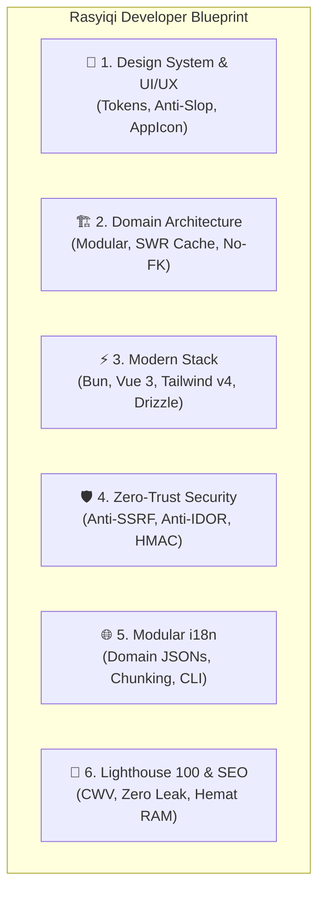

# ⚡ Rasyiqi Skill: The Signature Developer Blueprint

> **"Crafted by a developer-designer, engineered for scale, fortified by zero-trust security."**

**Rasyiqi-Skill** adalah repositori keahlian (*developer skill & architectural blueprint*) resmi yang mengekstraksi dan membakukan seluruh DNA rekayasa perangkat lunak, filosofi UI/UX, arsitektur sistem, dan standar keamanan yang dikembangkan dan disempurnakan melalui riset serta implementasi sistem produksi skala besar.

Skill ini dirancang agar saat membangun proyek, SaaS, atau web app baru, agen AI (Antigravity) dan tim developer langsung mengadopsi standar kualitas tinggi yang sama secara konsisten.

---

## 🏛️ 5 Pilar Utama Blueprint Rasyiqi



### 1. 🎨 Design System & UI/UX Craft ([Panduan Design System](./references/design-system.md) & [UI/UX Craft](./references/ui-ux-craft.md))
- **Design Tokens Formal**: Menggunakan token CSS terpusat via Tailwind CSS v4 ([`design-system.css`](./templates/design-system.css)) untuk Surface, Border, Elevation, Spacing 4px/8px, dan Radius konsentris.
- **Komponen Primitif Standar**: Tombol taktil (1 kata), Badge status, Form input berfokus jelas, Card bertingkat (Rule of 2 Levels), dan `<AppIcon>` vektor.
- **5 Dosa Besar AI Slop (DIHARAMKAN KERAS)**:
  1. ❌ **Palet Warna Pasaran (Gradasi Ungu, Biru Elektrik, Pink Neon)**: Dilarang memakai gradasi cyber/AI generik. Wajib gunakan *Layered Neutrals* yang tenang dengan aksen semantik terarah (Emerald, Amber, Rose, Indigo).
  2. ❌ **Tipografi Monoton & Kaku**: Dilarang tipografi seragam yang datar. Wajib kontras ritme yang tajam (*bold tracking-tight* untuk judul) dan `font-mono tracking-wider` untuk data teknis, finansial, dan kode.
  3. ❌ **Layout Card-in-Card Monoton & Hero Klise**: Dilarang formula klise (badge atas $\to$ H1 kiri $\to$ mockup 3D melayang kanan) dan 3 kotak simetris berulang. Wajib gunakan **Bento Grid Asimetris**, variasi ukuran kartu sesuai bobot informasi, dan hero kontekstual.
  4. ❌ **Antarmuka Dingin & Tanpa Jiwa (Steril)**: Tampilan tidak boleh kaku seperti robot. Wajib berjiwa dengan sentuhan mikro-interaksi taktil (`hover:scale-[1.02] active:scale-[0.98]`), transisi halus, dan sistem ikon vektor [`<AppIcon>`](./templates/AppIcon.vue) (bukan emoji mentah).
  5. ❌ **Logika UX Dangkal (Abaikan Edge Case)**: Dilarang hanya mendesain *happy path*. Wajib tangani kondisi nyata: nama teks sangat panjang (`truncate`/`line-clamp`), data kosong 0 item (empty state bermartabat), skeleton loader sesuai aspek rasio (anti-CLS), dan error state teknis yang solutif.
- **Strict Blacklist Operasional**:
  - ❌ **Dilarang Emoji Mentah di UI**: Wajib sistem vektor SVG seragam via [`<AppIcon>`](./templates/AppIcon.vue).
  - ❌ **Tolak Teks Abu-abu Buram**: Dilarang teks kontras rendah (`text-neutral-400` di atas `bg-neutral-100`). Selalu patuhi WCAG AA (min 4.5:1). Dark mode harus nyaman (`neutral-950`/`900`/`800`), bukan hitam pekat menusuk mata.
  - ❌ **Tolak Tombol Mati**: Tombol wajib memiliki respons sentuhan mikro (`hover:scale-[1.02] active:scale-[0.98] transition-all duration-150`).
  - ❌ **Tolak Modal Terpotong di Mobile**: Modal desktop wajib beralih menjadi *bottom-sheet drawer* di mobile (`max-sm:fixed max-sm:bottom-0 max-sm:rounded-t-2xl`). Tap target minimal $44 \times 44$ px ($48 \times 48$ dp di Android). Dilarang memaksakan pola desktop (popup dialog tengah layar, hover tooltips, pagination angka sempit) di layar sentuh.
  - ❌ **Tolak Container Inception & Padding Compounding**: Dilarang membungkus kotak di dalam kotak secara berlebihan (maksimal 2 tingkatan permukaan). Dilarang padding bertumpuk yang menyempitkan konten. Radius sudut wajib konsentris ($R_{\text{inner}} = \max(0, R_{\text{outer}} - \text{padding})$). Spasi wajib kelipatan 4px/8px.
  - ❌ **Tolak Teks Bertele-tele ("Kalau Mau Nulis Artikel Bukan Disini")**: Judul halaman cukup 1–2 kata; dilarang paragraf panjang di header. Tombol jika bisa 1 kata WAJIB 1 kata ("Simpan", "Tambah", "Hapus", "Salin", "Ekspor", "Filter", "Bayar"). Aksi tabel wajib berupa ikon mandiri (`<AppIcon>`). Dilarang tombol dobel redundan.
  - ❌ **Jangan Anggap User Bodoh (No Patronizing UX)**: Dilarang tur unskippable 5 langkah; dilarang dialog konfirmasi bawel untuk aksi reversibel (gunakan eksekusi instan + Undo toast); dilarang teks "Captain Obvious" yang mengulang label; dilarang empty state kartun merengek. Wajib dukung shortcut keyboard (`Esc`, `Cmd+S`, `Enter`) dan jangan pernah blokir paste password manager.
  - ❌ **Tolak Jargon Bombastis ("Don't Tell, But Show")**: Panggil fitur dengan bahasa jujur dan membumi (misal "Filter", "Ekspor CSV", bukan istilah sok keren). Sembunyikan penjelasan panjang di Tooltip (`<AppIcon name="help-circle" />`), jangan kotori layar. Dalam UI dan dokumentasi, selalu perlihatkan contoh nyata/preview langsung, bukan paragraf narasi kosong.
  - ❌ **Tolak Teks Hardcoded**: Semua teks antarmuka wajib dibungkus fungsi lokalisasi `$t(...)`.
- **The Taste Standard (Standar yang Disukai)**:
  - **Pola Sentuh & Gestur Khas Mobile**: Wajib adopsi interaksi alami jempol: Bottom Sheet drawer dengan pill drag handle dan swipe-to-dismiss, swipe-to-action pada baris list (kiri: hapus/rose, kanan: edit/emerald) dengan resistensi pegas (*snap-back*), long-press untuk aksi kontekstual & multi-seleksi diiringi getar haptik, horizontal scroll chips dengan snap alignment & edge fade gradient mask (tanpa scrollbar desktop), collapsing top bar saat scroll, dan scroll-aware FAB.
  - **Full-Edge Mobile (Minimal Round & Compact)**: Di mobile wadah menempel penuh ke tepi layar (`w-full border-x-0 border-y`), sudut minimal/tanpa lengkung (`rounded-none`/`rounded-sm`), kepadatan data kompak dan hemat ruang.
  - **Hairline Grid Desktop ("Dipisah Garis-Garis")**: Di desktop antarmuka mengadopsi estetika arsitektural Swiss Grid/Linear: panel dan baris menyatu (*docked*) dan dipisahkan oleh garis-garis hairline 1px tajam (`divide-x`, `divide-y`, `border-r`, `border-b`), bukan pulau kartu mengambang dengan shadow tebal.
  - Tampilan tenang, editorial, berwibawa dengan kedalaman **Layered Surfaces** (`neutral-50` $\to$ `neutral-100` $\to$ `white` pada light mode; `neutral-950` $\to$ `neutral-900` $\to$ `neutral-800` pada dark mode).
  - Warna semantik fungsional: Emerald (keuangan/sukses), Amber (VIP/perhatian), Rose (destruktif), Indigo (editor/teknis).
  - Tipografi tegas: Judul *bold tracking-tight*, angka transaksi dan kode kupon wajib `font-mono tracking-wider`.
  - **Android UI/UX Native Craft** ([Panduan Lengkap](./references/android-ui-ux-craft.md)): Ergonomi satu tangan (aksi 60% bawah layar, Bottom Sheet), gestur mobile khas (Drawer, Swipe-to-action, Long Press taktil, Horizontal Snap, Collapsing Top Bar, Pull-to-Refresh), true edge-to-edge full-bleed (`enableEdgeToEdge`), tactile haptic feedback, spring physics, dan proteksi RAM <80MB anti-LMK.

### 2. 🏗️ Arsitektur & Pola Rekayasa ([Panduan Lengkap](./references/architecture-patterns.md))
- **Domain-Driven Modularity**: Kode dibagi berdasarkan domain bisnis (`auth`, `products`, `orders`, `finance`, `hub`, `builder`, `admin`), bukan tipe file teknis.
- **No Database Foreign Keys (Application-Level Integrity)**: Dilarang constraint foreign key di database (`.references()`). Wajib gunakan kolom biasa bertipe dengan index eksplisit, dan kelola integritas referensial di application layer dalam transaksi atomik (`db.transaction`).
- **No Hardcoded Demo Data $\to$ Seed-First**: Dilarang mock data palsu di UI. Wajib skrip seed deterministik & idempoten (`bun run db:seed`).
- **Anti-God Files (Wajib <300–400 Baris)**: Dilarang file monolitik raksasa. Komponen, composable, dan backend layer wajib dipecah menjadi modul kecil berfokus tunggal.
- **Strict Folder Structuring (The 1-File Rule & Sibling Grouping)**:
  - **The 1-File Rule (Anti-Single-Child Folder)**: Jika dalam folder hanya ada 1 file, dilarang buat folder khusus (taruh langsung di parent).
  - **The Sibling Grouping Law**: Jika ada 3+ file dan 2+ diantaranya adalah saudara erat, wajib buatkan subfolder khusus untuk file bersaudara tersebut.
- **Proactive Refactoring & Import Healing**: Bebas me-rename dan memindahkan file ke folder domain seiring proyek berkembang, dengan kewajiban membetulkan seluruh import path terkait.
- **Ruthless Dead Code Elimination**: Hapus tuntas file, fungsi, dan aset yang sudah tidak dipakai agar repositori bersih dari *code rot*.
- **Komentar Kode Up-to-Date & Anti-Membingungkan**: Komentar wajib sinkron dengan kode terkini (*anti-comment drift*). Hapus komentar yang usang/tidak relevan. Komentar fokus menjelaskan "WHY" (alasan bisnis, keamanan, performa), bukan mengulang "WHAT" yang sudah jelas.
- **DRY & Pure Functions**: Ekstrak duplikasi kalkulasi ke pure functions yang teruji.
- **No Barrel Files (Direct Imports Only)**: Dilarang re-export `index.ts` (`export * from ...`) yang merusak tree-shaking dan memicu circular dependency. Wajib impor langsung secara eksplisit.
- **Zero Circular Dependencies**: Arsitektur wajib satu arah tanpa siklus memutar (`Schemas` $\to$ `Utils` $\to$ `Services` $\to$ `Routes` $\to$ `Views`).
- **SingleFlight SWR In-Memory Cache**: Menggabungkan (*coalescing*) query bersamaan untuk mencegah *thundering herd* / *cache stampede*, dengan *stale-while-revalidate* instan.
- **Atomic Transactions (`db.transaction`)**: Mutasi saldo, settlement pesanan, dan pemotongan stok wajib dibungkus dalam transaksi ACID.
- **Idempotent Webhook Pipeline**: Webhook gateway diverifikasi terhadap raw-body HMAC dan diduplikasi secara atomik untuk mencegah *replay attack*.
- **Wajib Berpikir Integratif (Integrative Systems Engineering)**: Rekayasa sistem dilakukan secara holistik hulu-ke-hilir: DTO TypeScript $\to$ validasi Zod $\to$ transaksi atomik $\to$ sinkronisasi cache SWR SingleFlight $\to$ token Tailwind v4 (mobile full-edge & desktop hairline) $\to$ kamus i18n domain $\to$ pembersihan lifecycle di `onBeforeUnmount()`.
- **Fitur Gak Boleh Prematur (Anti-Premature Engineering)**:
  - *Anti-Abstraksi Prematur (YAGNI)*: Dilarang abstraksi tebal spekulatif untuk kebutuhan fiksi. Kode harus konkret, modular (<300 baris), dan mudah di-refactor.
  - *Anti-Fitur Setengah Matang*: Dilarang tombol/menu palsu ("Segera hadir"). Wajib tuntas dengan validasi, loading state, empty state bermartabat, skeleton anti-CLS, error recovery, dan transaksi atomik.
- **Prinsip Fallback Proporsional (Error UI vs Layer Kedua)**: Tidak semua kegagalan membutuhkan fallback ke layer kedua. Sering kali yang paling benar, transparan, dan minim bug adalah langsung *fail-fast* dan fallback ke informasi error yang solutif di UI (misal: pembayaran ditolak, stok habis, kupon kedaluwarsa). Fallback layer kedua HANYA untuk kegagalan infrastruktur kritis yang idempoten (e.g. secondary email relay saat SMTP utama timeout).

### 3. ⚡ Tech Stack & Tooling ([Panduan Lengkap](./references/stack-tooling.md))
- **Matriks Prioritas Stack 1–10 (SEO & Hemat RAM/CPU VPS)**: Pilihan teknologi disesuaikan dengan kebutuhan proyek, namun diranking secara ketat berdasarkan Skor SEO dan Efisiensi Resource VPS ($4/bulan, 1 vCPU, 1 GB RAM):
  - **Prioritas 1 (Golden Tier)**: **Drizzle ORM** (zero runtime overhead, ~0 MB), **Bun Runtime** (ultra-lightweight ~30 MB idle), **Tailwind CSS v4** (bundle <15KB), **Vue 3 / Astro / Nuxt 3 SSG** (Lighthouse 100, LCP < 1.2s), dan **Elysia / Hono** (TTFB < 5ms).
  - **Prioritas 2–3**: Kysely, Svelte 5.
  - **Hindari Peringkat Bawah (P6–P10)**: Prisma (~200MB RAM daemon), Next.js (~500MB RAM server), dan NestJS (reflection bloat) yang memicu OOM di VPS murah.
- **Runtime**: **Bun** secara eksklusif (`bun run`, `bun test`, `bunx`, TypeScript native tanpa langkah kompilasi lambat).
- **Frontend**: **Vue 3 Composition API** dengan `<script setup lang="ts">` (atau **Astro / Nuxt 3 SSG** untuk konten publik). Type-safe props dan emits, composables terpisah.
- **Styling**: **Tailwind CSS v4** dengan pendekatan CSS-first (`@theme`) dan semantic design tokens.
- **Database & ORM**: **Drizzle ORM** (Prioritas 1) + PostgreSQL / SQLite. Schema-as-code murni, migrasi otomatis, dan performa tinggi tanpa runtime overhead.
- **Zero-Tolerance Quality Gates & Husky**:
  - Wajib bersih dari `tsc --noEmit` dan linter (0 error).
  - Dilarang `eslint-disable`, dilarang `@ts-ignore`, dilarang menyembunyikan problem (*solve, don't hide*).
  - Wajib Husky git hooks pada `pre-commit` (`locales:build`, `typecheck`, `lint`) dan `pre-push` (`test:unit`).
  - **Uji Mutu Lengkap & Coverage**: Wajib unit test komprehensif (`bun test`), monitor cakupan kode (`bun test --coverage`), dan pengujian alur penuh hulu-ke-hilir via test E2E (`bun test src/__tests__/e2e/`).
  - **Dokumentasi Progres (.md)**: Setiap perkembangan fitur besar, refactoring arsitektur, dan hasil pengujian wajib terdokumentasi secara persisten ke dalam file markdown terstruktur.
  - **In-Stride Documentation Law**: Dokumentasi teknis wajib dibuat dan disinkronkan berbarengan saat kode ditulis (*continuous in-stride* via TSDoc di kode dan panduan di `docs/`), dilarang menunda penulisan dokumentasi sebagai pekerjaan susulan.
- **Higienitas Variabel Lingkungan & Konvensi 4-File Env**: Jangan semua konfigurasi di-.env-kan! Hanya rahasia kriptografis fundamental (`DATABASE_URL`, `JWT_SECRET`, private keys) yang masuk `.env`. Untuk integrasi pihak ketiga yang memiliki siklus Sandbox dan Live Production (payment gateway, ekspedisi, SMS/WA), wajib sediakan 4 file env terpisah: `.env.example` (template skema publik di git), `.env.sandbox` (kredensial tes & simulator), `.env.production` (kredensial live riil), dan `.env` (salinan aktif lokal). Hal sepele seperti nomor port, URL default lokal, timeout, atau limit paginasi wajib memiliki *sensible in-code defaults* (`port || 3000`). Pengaturan dinamis dikelola via database (`systemSettings`).

### 4. 🛡️ Keamanan Berlapis / Zero Trust ([Panduan Lengkap](./references/security-compliance.md))
- **Anti-SSRF Safe Outbound Fetcher**: Melakukan inspeksi DNS dan memblokir request ke IP privat/loopback/cloud metadata (`127.0.0.1`, `10.0.0.0/8`, `169.254.169.254`).
- **Anti-IDOR Multi-Tenant Guard**: Setiap query DB wajib memfilter berdasarkan `tenantId` / `storeId` dari sesi terverifikasi server.
- **Privilege Isolation**: Token tamu (buyer/hub) diisolasi agar tidak pernah bisa eskalasi hak akses ke peran merchant/superadmin.
- **Sanitasi Konten**: Sanitasi HTML user-generated menggunakan DOMPurify dan validasi skema ketat.

### 5. 🌐 Modular Localization (i18n) ([Panduan Lengkap](./references/modular-i18n.md))
- **Domain Partitioning**: Mengeliminasi file raksasa >7.000 baris menjadi file domain ringkas (200–1.500 baris).
- **Optimized Bundle Chunking**: `id-core.json` (~26 KB) dimuat di awal untuk FCP secepat kilat, sementara modul lanjutan dimuat secara dinamis.
- **Automated CLI Tooling**: Menambah string terjemahan baru dalam 1 baris terminal tanpa membuka file JSON secara manual (`bun run i18n:add`).

### 6. 🚀 Lighthouse 100, SEO & Efisiensi Resource ([Panduan Lengkap](./references/performance-lighthouse-seo.md))
- **Lighthouse Skor 100/100**: Standar perfeksionis untuk Performance ($\ge 98$), Accessibility (100), Best Practices (100), dan SEO (100).
- **Core Web Vitals Ketat**: LCP $< 1.2\text{s}$ (hero preload), INP $< 100\text{ms}$ (anti-long-tasks, debounced inputs), CLS $= 0.00$ (aspek rasio eksplisit, matching skeleton).
- **SEO & Browser Standards**: Semantic HTML5 (1 `<h1>`), dynamic OpenGraph/Twitter card, Schema.org JSON-LD structured data.
- **Hemat CPU & RAM (Stack Ringan)**: Runtime Bun ultra-cepat, zero memory leaks (pembersihan listener di `onBeforeUnmount`), dan animasi GPU-only (anti-CPU 100% spike).

---

## 📁 Struktur Direktori Repositori

```text
/media/rasyiqi/7653717A1C07B131/Rasyiqi-Skill/
├── SKILL.md                         # Master manifest skill untuk agen Antigravity
├── README.md                        # Dokumentasi & panduan ini
│
├── references/                      # Panduan teknis mendalam
│   ├── design-system.md             # Formal tokens, radius konsentris, grid spasi, komponen primitif
│   ├── ui-ux-craft.md               # Standar visual, typography, palet, micro-interactions, anti-slop
│   ├── android-ui-ux-craft.md       # Standar UI/UX Android native (thumb-zone, edge-to-edge, haptics, LMK)
│   ├── architecture-patterns.md     # Modul domain, cache SWR, transaksi ACID, no-FK, 1-file rule
│   ├── stack-tooling.md             # Matriks prioritas stack 1-10, Bun, Vue 3, Tailwind v4, Drizzle, Husky
│   ├── security-compliance.md       # Anti-SSRF, Anti-IDOR, isolasi privilege, HMAC
│   ├── modular-i18n.md              # Arsitektur kamus terjemahan modular & tooling CLI
│   └── performance-lighthouse-seo.md# Lighthouse 100, Core Web Vitals, SEO, CPU/RAM hygiene
│
├── templates/                       # Boilerplate & modul siap pakai
│   ├── AppIcon.vue                  # Komponen ikon vektor SVG multi-tema
│   ├── design-system.css            # Token CSS Tailwind v4 (surface, border, radius, shadow)
│   ├── inMemoryCache.ts             # Cache SingleFlight SWR anti-thundering-herd
│   ├── safeOutboundUrl.ts           # Validator URL & DNS anti-SSRF
│   ├── split-locales.ts             # Compiler otomatis i18n modular
│   ├── i18n-add.ts                  # CLI helper penambah kunci terjemahan
│   └── db-schema-starter.ts         # Starter schema & transaksi Drizzle ORM tanpa foreign key
│
└── scripts/                         # Skrip instalasi otomatis
    ├── install-globally.sh          # Pasang global ke ~/.gemini/config/skills/
    └── install-to-workspace.sh      # Tautkan ke proyek baru (.agents/skills/)
```

---

## 🚀 Cara Menggunakan & Instalasi

### 1. Instalasi Global (Otomatis Aktif untuk Semua Proyek Antigravity)
Skill ini telah ditautkan ke direktori konfigurasi global Antigravity:
```bash
./scripts/install-globally.sh
# Target: ~/.gemini/config/skills/rasyiqi-skill -> /media/rasyiqi/7653717A1C07B131/Rasyiqi-Skill
```
Setelah langkah ini, di proyek mana pun Anda bekerja, agen AI Antigravity akan otomatis mengenali dan dapat mengaktifkan `rasyiqi-skill`.

### 2. Memasang ke Repositori Proyek Spesifik
Jika Anda ingin menyematkan skill ini ke dalam folder workspace proyek lain:
```bash
/media/rasyiqi/7653717A1C07B131/Rasyiqi-Skill/scripts/install-to-workspace.sh /path/ke/proyek-baru
```
Skrip ini akan membuat symlink di `/path/ke/proyek-baru/.agents/skills/rasyiqi-skill`.

### 3. Cara Memberi Instruksi ke AI Agent
Cukup katakan kepada agen pada prompt awal proyek:
> *"Gunakan standar rasyiqi-skill untuk membangun aplikasi ini."*
> atau
> *"Ikuti blueprint Rasyiqi untuk UI/UX, arsitektur backend, dan keamanannya."*

Agen akan langsung membaca manifest [`SKILL.md`](./SKILL.md) dan seluruh panduan di `references/` untuk mereplikasi kualitas, gaya, dan performa tinggi khas standar Rasyiqi.
