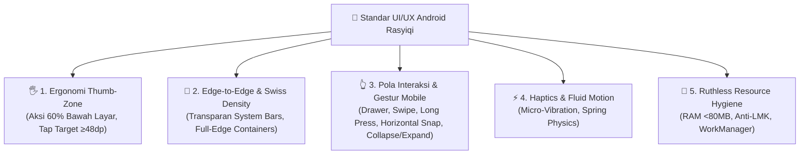
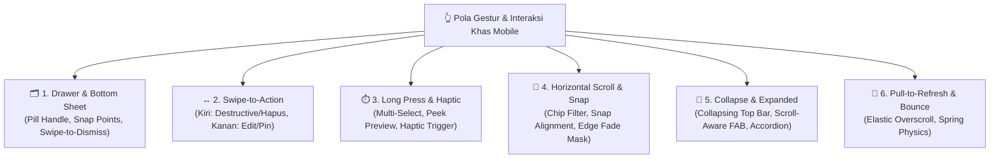
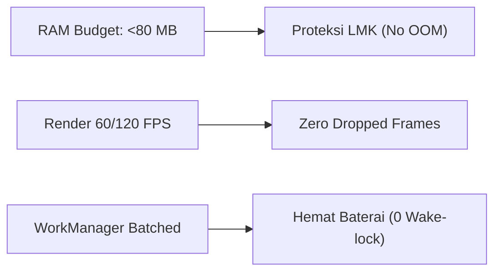

# Rasyiqi Android UI/UX & Resource Craft Specification

> **"Mobile craft is defined by thumb ergonomics, edge-to-edge aesthetics, tactile haptics, and ruthless battery & RAM hygiene."**

Dokumen ini adalah spesifikasi resmi standar **UI/UX dan Rekayasa Resource untuk Android** dalam ekosistem Rasyiqi. Standar ini memastikan bahwa aplikasi Android yang dibangun tidak hanya berkelas (*anti-slop*), ergonomis, dan intuitif, tetapi juga ultra-ringan, hemat baterai, dan berjalan mulus (60/120 FPS) di perangkat Android low-end (RAM 2–3 GB).

---

## 1. Filosofi Desain UI/UX Android Rasyiqi

---

## 2. Ergonomi Thumb-Zone (Navigasi Satu Tangan)

Layar smartphone modern rata-rata berukuran 6.5–6.8 inci. Jempol manusia hanya dapat menjangkau area bawah secara alami:

### A. The 60% Bottom Rule
1. **Aksi Primer Wajib di Bawah**:
   - Tombol utama (*Primary CTA*), filter, tab selektor, dan navigasi utama wajib diletakkan di area 60% bawah layar.
   - Dilarang menempatkan tombol konfirmasi krusial atau navigasi sering di pojok kiri atas (sulit dijangkau tanpa menggunakan dua tangan).
2. **Bottom-Sheet Over Dialog**:
   - Gantikan dialog modal pop-up tengah layar dengan **Modal Bottom Sheet** (`ModalBottomSheet` di Jetpack Compose atau BottomSheetDialogFragment).
   - Mudah dibuka, ditarik, dan ditutup dengan sapuan jempol (*swipe-to-dismiss*).
3. **Ukuran Tap Target Minimal**:
   - Setiap elemen sentuh wajib memiliki ukuran fisik minimal **$48 \times 48\text{ dp}$** dengan padding sentuh (*touch target expansion*), mencegah saltik (*misclick*).

---

## 3. Tata Letak Edge-to-Edge (Full-Bleed) & Kepadatan Visual

### A. True Edge-to-Edge (`enableEdgeToEdge`)
Aplikasi modern tidak boleh menampilkan status bar atau navigation bar hitam/putih pekat yang memotong layar seperti aplikasi jadul:
- **Tembus System Bars**: Konten aplikasi wajib digambar menembus hingga ke balik *status bar* dan *gesture navigation bar* (`enableEdgeToEdge()` di `ComponentActivity`).
- **Penanganan Insets yang Tepat**: Gunakan `WindowInsetsCompat` atau `Modifier.windowInsetsPadding(WindowInsets.safeDrawing)` agar teks atau tombol interaktif tidak tertutup oleh kamera punch-hole atau garis gesture navigasi bawah.

### B. Full-Edge Containers & Sudut Proporsional
- Di Android, hindari menaruh kartu-kartu kecil mengambang yang memiliki margin samping tebal (`margin = 24dp`) dan sudut bulat raksasa (`rounded = 32dp`). Pola itu menyempitkan ruang baca.
- Gunakan kontainer **Full-Edge** dengan garis pembatas tipis (*hairline divider* 1dp warna `neutral-200 dark:neutral-800`), sudut minimal (`rounded-sm` / 4–8dp), dan kepadatan data yang kompak.

---

## 4. Pola Interaksi & Gestur Khas Mobile (Mobile-Native Interaction Patterns)

Antarmuka mobile bukan sekadar tampilan web yang diperkecil; mobile hidup dari **interaksi jempol dan gestur taktil**:

### A. Drawer & Modal Bottom Sheet (Bukan Pop-Up Dialog Tengah Layar)
1. **Pill Handle Indicator**:
   - Setiap bottom sheet wajib memiliki indikator pegangan (*drag handle*) di bagian atas tengah (`w-10 h-1 rounded-full bg-neutral-300 dark:bg-neutral-700 mx-auto mt-2 mb-3`) sebagai petunjuk visual (*visual affordance*) bahwa panel dapat ditarik atau disapu.
2. **Snap Points & Physics**:
   - Sediakan titik henti terukur (*snap points*):
     - *Peek state*: 35–40% tinggi layar (untuk melihat sekilas rincian/aksi cepat).
     - *Expanded state*: 85–90% tinggi layar (untuk form atau daftar panjang).
   - Penutupan bottom sheet wajib mendukung sapuan ke bawah (*swipe-down to dismiss*) dengan kecepatan sapuan (*velocity threshold*) dan pegas (*spring physics*).
3. **Modal Drawer untuk Hierarki Navigasi**:
   - Gunakan *Navigation Drawer* sisi kiri untuk navigasi antar-modul utama pada aplikasi berfitur banyak, dapat ditarik dengan sapuan dari tepi kiri layar (*edge drag*).

### B. Swipe Gestures (Aksi Cepat Baris & Navigasi Alami)
1. **Swipe-to-Action pada Daftar Baris**:
   - Berikan aksi instan saat baris digeser secara horizontal:
     - **Swipe Kiri (Destruktif / Aksi Keras)**: Membuka latar merah mawar (`bg-rose-600`), ikon tong sampah putih, dan teks ringkas "Hapus". Memicu haptic warning saat threshold tersapu (>40% lebar item).
     - **Swipe Kanan (Konstruktif / Primer)**: Membuka latar hijau zamrud (`bg-emerald-600`), ikon centang atau pin, dan teks ringkas "Selesai" / "Sematkan".
2. **Threshold Resistance & Snap Back**:
   - Jika geseran dilepas sebelum batas ambang (*trigger threshold* <35%), baris wajib membal kembali secara otomatis (*snap back spring*) ke posisi semula tanpa memicu aksi tak disengaja.
3. **Edge-Swipe Predictive Back**:
   - Dukung penuh gestur kembali bawaan OS (Android 14+ Predictive Back) dari tepi layar kiri/kanan tanpa memotong area geser internal komponen.

### C. Long Press (Aksi Kontekstual & Multi-Seleksi Taktil)
1. **Pemicu Multi-Seleksi Cepat**:
   - Tekan-tahan (*long press* 350ms–500ms) pada item daftar otomatis mengaktifkan mode seleksi massal (*multi-select mode*), menampilkan checkbox pada seluruh baris dan toolbar aksi kontekstual di atas/bawah.
2. **Umpan Balik Haptik Tepat Waktu**:
   - Long press **wajib** menghasilkan sentakan haptik instan (`HapticFeedbackType.LongPress`) tepat saat durasi waktu terpenuhi, memberi konfirmasi fisik sebelum jari dilepas.
3. **Peek & Pop Preview**:
   - Tekan-tahan pada kartu gambar, bukti transfer, atau dokumen untuk menampilkan jendela pratinjau mengambang sementara (*floating peek modal*). Melepaskan jari langsung menutup modal tanpa perlu menekan tombol 'Tutup'.

### D. Horizontal Scroll & Snap (Kategori, Chip Filter, & Kartu Berjejer)
1. **Filter Chip Mendatar**:
   - Kelompok filter status, tab kategori, atau tag disusun dalam satu baris horizontal (`LazyRow` atau `overflow-x-auto`) sehingga tidak memakan tinggi vertikal layar.
2. **Snap Alignment & Momentum**:
   - Saat digeser, elemen kartu/chip wajib berhenti tepat di posisinya (*scroll snap points* / `rememberSnapFlingBehavior`), bukan mengambang setengah terpotong di tepi layar.
3. **Hilangkan Scrollbar Desktop**:
   - Matikan tampilan batang scrollbar tebal yang merusak estetika (`scrollbar-none` / `showsHorizontalScrollIndicator = false`).
4. **Edge Fade Gradient Mask**:
   - Terapkan efek memudar (*gradient fade mask*) di ujung kanan (atau kiri saat di-scroll) untuk memberi tahu pengguna secara halus bahwa masih ada item berikutnya yang bisa digeser.

### E. Collapsible & Expandable (Pemanfaatan Ruang Layar & Hirarki Data)
1. **Collapsing Top App Bar**:
   - Gunakan pola *Large Title to Compact Bar*. Saat pengguna melakukan scroll ke bawah, judul besar halaman meluruh (*collapse*) menjadi toolbar ringkas yang menempel di atas layar, memaksimalkan area baca data.
2. **Scroll-Aware Floating Action Button (FAB)**:
   - Tombol aksi utama mengambang (*FAB*) otomatis menyusut (*collapse to icon-only*) atau meluncur ke bawah saat pengguna men-scroll ke bawah, dan muncul kembali seketika saat arah scroll berbalik ke atas.
3. **Smooth Accordion & Inline Expand**:
   - Rincian data yang panjang disajikan dalam *accordion* yang dapat dilipat/dibuka. Animasi panah chevron berputar halus ($180^\circ$) diiringi transisi ketinggian berbasis spring physics tanpa jeda layout rendering.

### F. Pull-to-Refresh & Tactile Overscroll
1. **Resistensi Pegas Elastis**:
   - Tarikan ke bawah dari puncak daftar (*pull-to-refresh*) menggunakan resistensi pegas elastis. Indikator berupa spinner minimalis monokrom yang berputar halus.
2. **Proteksi False Trigger**:
   - Batasi pemicu refresh hanya pada tarikan vertikal murni di posisi paling atas list ($Y=0$). Gerakan menyamping atau saat list sedang berada di tengah scroll dilarang memicu refresh.

---

## 5. Haptic Feedback & Dynamic Motion (Jiwa Antarmuka)

Antarmuka tanpa umpan balik fisik terasa dingin dan robotik:

1. **Umpan Balik Taktil (Haptic Micro-Vibrations)**:
   - Berikan getaran haptic halus saat:
     - Menekan tombol aksi penting (*toggle*, *save*, *delete*).
     - Menggeser (*slider*, *wheel picker*).
     - Sukses transaksi (konfirmasi haptic dua ketukan pendek).
     - Kesalahan input / validasi (haptic peringatan).
   - Gunakan `LocalHapticFeedback.current.performHapticFeedback(HapticFeedbackType.LongPress)` atau API `Vibrator` berstandar modern.
2. **Spring Physics & Predictive Back**:
   - Hindari animasi linier yang kaku. Gunakan animasi berbasis fisika pegas (*spring animations*) untuk overscroll, swipe-to-dismiss, dan expandable cards.
   - **Dukung Predictive Back Gesture** (Android 14+): Pengguna dapat melihat intipan layar sebelumnya saat menggeser tepi layar sebelum melepaskan jari.

---

## 6. Ruthless Resource & Battery Hygiene (Android Performance)

Di Android, sistem operasi memiliki **Low Memory Killer (LMK)**. Jika aplikasi memakan terlalu banyak RAM atau CPU, Android akan langsung mematikan aplikasi di latar belakang (*background kill*):

### A. Anggaran RAM (<60–80 MB Baseline) & Anti-Memory Leak
1. **Dilarang Context Leak**:
   - Dilarang menyimpan referensi `Activity` atau `Context` UI di dalam objek singleton, static companion, atau background thread. Gunakan `applicationContext` jika hanya butuh akses sistem.
2. **Lifecycle-Aware Coroutines**:
   - Seluruh background coroutine wajib terikat pada `viewModelScope` atau `lifecycleScope`. Jangan pernah menggunakan `GlobalScope` yang terus berjalan saat layar sudah ditutup.
3. **Manajemen Gambar Hemat Memori**:
   - Gunakan pustaka Coil / Glide dengan ukuran decoding sesuai dimensi `ImageView` (downsampling).
   - Aktifkan `Bitmap.Config.HARDWARE` untuk me-render bitmap langsung ke memori GPU tanpa menduplikasi alokasi di heap RAM.
4. **Bersihkan Observer & Listener**:
   - Di Jetpack Compose, gunakan `DisposableEffect` untuk melepas sensor listener, GPS updates, atau audio player saat composable keluar dari komposisi (*unmounted*).

### B. Proteksi Baterai & Beban CPU
1. **Dilarang Polling di Background**:
   - Dilarang membuat `Timer` atau `Thread.sleep` berulang di background service untuk mengecek data baru.
   - Gunakan **Push Notification (FCM)** untuk memicu pengambilan data atau **WorkManager** dengan batasan pintar (*Constraints: NetworkType.CONNECTED, BatteryNotLow*).
2. **60 / 120 FPS Smooth Scrolling (Zero Frame Drops)**:
   - Komputasi berat (formatting tanggal ribuan item, kalkulasi finansial, regex) **dilarang berjalan di Main UI Thread**. Wajib gunakan `withContext(Dispatchers.Default)` atau `Dispatchers.IO`.
   - Di Jetpack Compose, tandai model data dengan `@Immutable` atau `@Stable` agar compiler dapat melakukan *smart recomposition skipping*.
3. **Penyusutan Ukuran Binary (R8 & ProGuard)**:
   - Aktifkan `isMinifyEnabled = true` dan `isShrinkResources = true` pada build release.
   - Gunakan **Vector Drawable (XML / SVG)** untuk ikon, hindari menaruh aset raster PNG/JPEG beresolusi raksasa. Target ukuran APK di bawah 15 MB.

---

## 7. Checklist Kematangan Aplikasi Android Sebelum Rilis

- [ ] `enableEdgeToEdge()` aktif dengan padding insets yang presisi di semua orientasi.
- [ ] Tap target seluruh tombol interaktif $\ge 48 \times 48\text{ dp}$.
- [ ] Tombol aksi primer berada dalam jangkauan satu tangan (area 60% bawah layar).
- [ ] Pola modal bottom sheet menggunakan pill drag handle dan mendukung swipe-to-dismiss.
- [ ] Baris list data mendukung gesture swipe-to-action (kiri: hapus/merah mawar, kanan: edit/pin) dengan snap-back spring.
- [ ] Long press memicu haptic micro-vibration seketika dan membuka contextual actions / multi-select.
- [ ] Horizontal scroll chips dilengkapi snap alignment dan gradient fade mask di ujung layar tanpa scrollbar desktop.
- [ ] Collapsing header dan scroll-aware FAB meluncur mulus (60/120 FPS) merespons arah scroll.
- [ ] Haptic feedback aktif pada interaksi penting.
- [ ] Memori RAM idle di bawah 80 MB (lolos uji Memory Profiler Android Studio).
- [ ] Bebas memory leak (terverifikasi via LeakCanary).
- [ ] Tidak ada pekerjaan background tanpa batasan WorkManager.
- [ ] Dark theme berwibawa (*true neutral/OLED*, bukan abu-abu pudar).
- [ ] Bebas emoji mentah di komponen visual (wajib vektor XML seragam).
