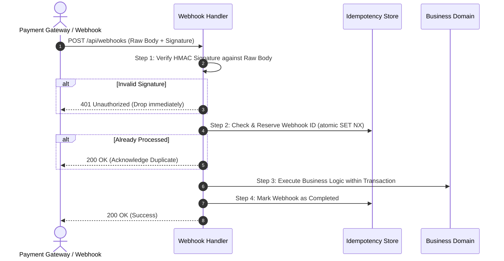
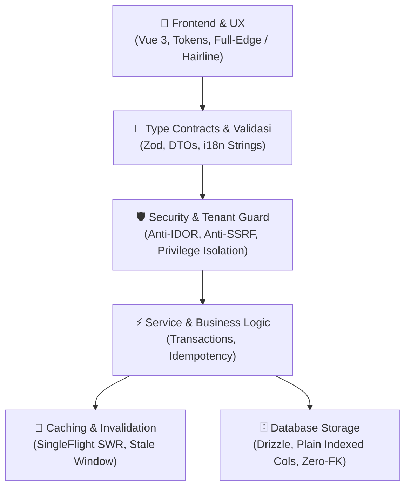

# Rasyiqi Architecture & Engineering Patterns

This document defines the architectural patterns, data flow conventions, and concurrency primitives established for high-traffic, production-grade SaaS systems.

---

## 1. Domain-Driven Modular Layout

Every backend and frontend codebase should be partitioned by **business domain**, not by technical artifact type:

```text
src/
├── client/                     # Vue 3 Frontend
│   ├── components/
│   │   ├── common/             # Reusable design primitives (AppIcon, Modal, Button)
│   │   └── <domain>/           # Domain-specific components (orders/, products/, checkout/)
│   ├── views/
│   │   └── <domain>/           # Routable view pages
│   ├── composables/            # Shared reactive composables (useCurrency, useToast)
│   └── locales/                # Modular i18n dictionaries partitioned by domain
│
└── server/                     # Backend API & Worker Engine
    ├── core/                   # Platform infrastructure (Zero business logic)
    │   ├── db/                 # Drizzle connection, schema definitions, migrations
    │   ├── cache/              # SingleFlight SWR in-memory and Redis caches
    │   ├── security/           # Anti-SSRF, rate limiting, auth token verifiers
    │   └── utils/              # Crypto, formatters, HTTP wrappers
    │
    └── modules/                # Business Domains (Self-contained)
        ├── auth/               # Identity, sessions, passkeys
        ├── products/           # Catalog, digital vault, physical inventory
        ├── orders/             # Order state machine, checkout, invoicing
        ├── payment/            # Gateway adapters (DOKU, Midtrans, Tripay)
        ├── hub/                # Customer portal, LMS, bookings, VIP
        └── admin/              # Superadmin analytics, finance, moderation
```

Each module under `src/server/modules/<domain>/` contains:
- `routes.ts`: HTTP route definitions with schema validation.
- `service.ts`: Business logic and orchestration.
- `types.ts`: DTO interfaces and request/response contracts.

---

## 2. Atomic Database Transactions

Financial settlements, balance deductions, stock updates, and order state transitions **must never be executed as separate loose SQL statements**. They must always be wrapped in ACID transactions:

```typescript
// Pattern: Atomic Transaction with Drizzle ORM
export async function completeOrderSettlement(orderId: string, merchantId: string, grossAmount: number) {
  return await db.transaction(async (tx) => {
    // 1. Lock and update order status
    const [order] = await tx
      .update(orders)
      .set({ status: 'PAID', paid_at: new Date() })
      .where(and(eq(orders.id, orderId), eq(orders.status, 'PENDING')))
      .returning();

    if (!order) {
      throw new Error('Order not found or already processed');
    }

    // 2. Compute platform fee and net payout
    const platformFee = Math.round(grossAmount * 0.02);
    const netPayout = grossAmount - platformFee;

    // 3. Atomically increment merchant balance
    await tx
      .update(merchantWallets)
      .set({
        balance: sql`${merchantWallets.balance} + ${netPayout}`,
        updated_at: new Date()
      })
      .where(eq(merchantWallets.userId, merchantId));

    // 4. Log immutable ledger entry
    await tx.insert(ledgerEntries).values({
      orderId,
      merchantId,
      grossAmount,
      platformFee,
      netAmount: netPayout,
      type: 'ORDER_SETTLEMENT'
    });

    return order;
  });
}
```

---

## 3. High-Concurrency SingleFlight SWR Caching

To prevent **thundering herd** problems when hundreds of concurrent requests request the same expensive report, API call, or database query:

1. **SingleFlight Mutex**: If request $A$ is computing a cache miss, requests $B, C, D$ join request $A$'s Promise instead of dispatching new backend queries.
2. **Stale-While-Revalidate (SWR)**: Serve existing cached data immediately while refreshing the cache in the background if the stale window is reached.

```typescript
import { inMemoryCache } from './core/cache/inMemoryCache.js';

export async function getStoreAnalytics(storeId: string) {
  const cacheKey = `analytics:store:${storeId}`;

  return await inMemoryCache.getOrCompute(
    cacheKey,
    async () => {
      // Expensive aggregated database queries
      return await computeHeavyStoreMetrics(storeId);
    },
    {
      ttlMs: 60_000,              // Fresh for 60 seconds
      staleWhileRevalidate: true,  // Serve stale while computing in background
      maxAgeMs: 300_000            // Stale allowed up to 5 minutes
    }
  );
}
```

See [inMemoryCache.ts](../assets/inMemoryCache.ts) for the reference implementation.

---

## 4. Idempotent Webhook Pipeline

External webhook providers (e.g., payment gateways, shipping couriers, third-party messaging) frequently retry delivery. All webhook handlers must follow this 4-step pipeline:



### Golden Rules:
1. **Raw Body Only**: HMAC verification must always use the raw unparsed request body string (never `JSON.stringify(req.body)`, which alters key order and spacing).
2. **Immediate 200 on Duplicate**: If an idempotency key exists and was already resolved, return `200 OK` immediately so the external service stops retrying.

---

## 5. Clean Engineering Standards (Code Quality & Modularity Law)

Prinsip kode di Rasyiqi: **Bersih, modular, tanpa data palsu di UI, tanpa barrel file, tanpa ketergantungan sirkular, dan anti-file raksasa.**

### A. Anti-Hardcoded Demo Data $\to$ Seed-First Philosophy
- ❌ **DILARANG**: Menaruh array data dummy / mock hardcoded langsung di dalam komponen Vue atau controller API:
  ```typescript
  // ❌ DILARANG: Dummy data palsu yang mengotori komponen
  const mockProducts = [
    { id: '1', name: 'Produk A', price: 100000 },
    { id: '2', name: 'Produk B', price: 200000 }
  ];
  ```
- ✅ **STANDAR WAJIB**:
  - Sediakan skrip database seed yang deterministik dan idempoten (`bun run db:seed` di `src/server/core/db/seed.ts`).
  - Komponen UI wajib mengonsumsi data nyata dari API terverifikasi atau state reaktif yang terdefinisi dengan tipe TypeScript lengkap.

### B. Anti-God Files: Wajib Pecah Kode Menjadi Modular (<300–400 Baris)
- ❌ **DILARANG**: Menulis satu file monolitik raksasa (>500–1.000 baris) yang mencampuradukkan template, state management, form validation, dan routing.
- ✅ **STANDAR WAJIB**:
  - Batasi panjang file maksimal **300–400 baris**. Jika melebihi, pecah segera!
  - **Pecah Komponen UI**: Pisahkan kartu ringkasan, dialog modal, baris tabel, dan form editor ke dalam sub-komponen terfokus di subfolder domain (`components/orders/OrderSummaryCard.vue`, `OrderReceiptModal.vue`).
  - **Pecah Logika Bisnis ke Composable**: Ekstrak logika state dan kalkulasi ke composable mandiri (`composables/useOrderCheckout.ts`).
  - **Pemisahan Lapisan Server**: Pisahkan dengan tegas: `routes.ts` (definisi rute & validasi Zod) $\to$ `service.ts` (orkestrasi bisnis & transaksi) $\to$ `schema.ts` (definisi tabel DB).

### C. DRY (Don't Repeat Yourself) & Pure Utility Functions
- ❌ **DILARANG**: Menyalin-tempel formula perhitungan (pajak, komisi, diskon kupon, format rupiah, formatting tanggal) di 5 tempat berbeda.
- ✅ **STANDAR WAJIB**:
  - Ekstrak seluruh formula dan utilitas kalkulasi menjadi fungsi murni (*pure functions*) yang teruji (*unit-tested*) di `core/utils/` atau `composables/`.
  - Jika logika yang sama muncul di 2 tempat berbeda, segera lakukan refactoring menjadi shared utility.

### D. Anti-Barrel Files: Direct & Explicit Imports Only
- ❌ **DILARANG KERAS**: Menggunakan *barrel files* (file `index.ts` yang hanya berisi deretan `export * from './...'`):
  ```typescript
  // ❌ DILARANG: Re-export barrel file yang memperlambat bundler dan merusak tree-shaking
  // src/utils/index.ts
  export * from './currency';
  export * from './dates';
  export * from './strings';
  export * from './math';
  ```
- **Mengapa Barrel Files Diharamkan?**
  1. **Tree-Shaking Rusak**: Saat mengimpor satu helper kecil, Vite/Rollup terpaksa memuat seluruh modul di dalam folder tersebut.
  2. **Biang Kerok Circular Dependencies**: Modul A mengimpor dari barrel, barrel mengimpor B, dan B mengimpor kembali modul A.
  3. **Mengaburkan Asal Usul Modul**: Developer tidak bisa melihat secara transparan file mana yang sebenarnya menyediakan fungsi tersebut.
- ✅ **STANDAR WAJIB: Impor Eksplisit & Langsung**:
  ```typescript
  // ✅ BENAR: Impor langsung ke sumber file yang dituju
  import { formatRupiah } from '@/client/utils/currency.js';
  import { calculateDiscount } from '@/server/modules/coupons/calculator.js';
  ```

### E. Zero Circular Dependencies (Unidirectional Architecture)
- ❌ **DILARANG**: Ketergantungan memutar (Circular Dependency) di mana File A mengimpor File B, dan File B secara langsung atau tidak langsung mengimpor kembali File A. Ini menyebabkan runtime error `undefined`, *Temporal Dead Zone (TDZ)* crash, dan kegagalan kompilasi bundler.
- ✅ **STANDAR WAJIB**:
  - Arsitektur wajib memiliki aliran dependensi **satu arah (*unidirectional acyclic graph*)**:
    $$\text{Schemas / Types} \longrightarrow \text{Core / Utils} \longrightarrow \text{Services} \longrightarrow \text{Routes / Controllers} \longrightarrow \text{Client Views}$$
  - Lapisan bawah **dilarang pernah** mengimpor dari lapisan atas (misal schema database tidak boleh mengimpor route controller).

### F. No Foreign Keys in Database (Application-Level Referential Integrity)
- ❌ **DILARANG**: Menggunakan *database-level foreign key constraints* (`.references()`, `FOREIGN KEY ... REFERENCES`):
  ```typescript
  // ❌ DILARANG: Constraint database yang memicu lock contention & menyulitkan sharding
  export const orders = pgTable('orders', {
    userId: text('user_id').notNull().references(() => users.id), // HINDARI!
  });
  ```
- **Mengapa Foreign Key Database Ditolak?**
  1. **Lock Contention & Deadlocks**: Setiap operasi INSERT/UPDATE/DELETE pada tabel pesanan memaksa database mengunci baris di tabel pengguna untuk validasi, menjadi *bottleneck* parah saat *high-concurrency traffic*.
  2. **Menyulitkan Skalabilitas & Sharding**: Constraint DB tidak bekerja saat database di-shard secara horizontal (misal via Vitess / Citus / PlanetScale) atau saat tabel dipisahkan ke microservice terpisah.
  3. **Migrasi Lambat & Kaku**: Mengubah skema tabel yang memiliki foreign key membutuhkan *table lock* yang panjang dan sering gagal saat zero-downtime migration.
  4. **Bencana Cascade Delete**: `ON DELETE CASCADE` di tingkat DB berisiko tinggi menghapus ribuan riwayat transaksi/invoice finansial penting secara tidak sengaja.
- ✅ **STANDAR WAJIB: Integritas di Application Layer**:
  - Kolom relasi didefinisikan sebagai kolom biasa bertipe (misal `userId: text('user_id').notNull()`) dan **diberi index eksplisit** untuk performa query join/filter:
    ```typescript
    // ✅ STANDAR RASYIQI: Kolom biasa + Index eksplisit
    export const orders = pgTable('orders', {
      id: text('id').primaryKey().default(sql`gen_random_uuid()`),
      userId: text('user_id').notNull(),
      totalAmount: integer('total_amount').notNull(),
    }, (table) => [
      index('orders_user_id_idx').on(table.userId)
    ]);
    ```
  - Validasi keberadaan relasi dan audit trail dikelola sepenuhnya di dalam service aplikasi dengan transaksi atomik (`db.transaction`).
  - Gunakan **Soft Delete** (`deletedAt: timestamp('deleted_at')`), bukan *hard delete* fisik.

### G. Struktur Folder Presisi: The 1-File Rule & Sibling Grouping Law
Struktur folder harus bersih, teratur, dan memiliki alasan fungsional yang kuat:
1. **The 1-File Rule (Anti-Single-Child Folder)**:
   - Jika di dalam suatu folder **hanya ada 1 file tunggal**, maka **DILARANG membuat folder khusus untuk file tersebut!**
   - ❌ *DILARANG*: `components/modal/BaseModal.vue` di mana folder `modal/` tidak memiliki file lain sama sekali.
   - ✅ *BENAR*: Simpan langsung di level induknya: `components/BaseModal.vue`.
   - Folder tunggal hanya menambah kedalaman path yang tidak perlu dan memperlambat pencarian file (*unnecessary nested traversal*).
2. **The Sibling Grouping Law (>2 File Bersaudara)**:
   - Jika di dalam suatu direktori terdapat 3 file atau lebih, dan 2 atau lebih di antaranya memiliki hubungan fungsional yang sangat erat (**file bersaudara / domain siblings**), maka **WAJIB buatkan subfolder khusus untuk file-file bersaudara tersebut**:
     - *Contoh*: Di folder `components/common/` terdapat 4 file: `ProductCard.vue`, `OrderSummaryCard.vue`, `OrderPaymentStatus.vue`, `OrderReceiptModal.vue`.
     - Tiga file `Order*` adalah "saudara satu domain". Maka **wajib difolderkan**:
       `components/orders/OrderSummaryCard.vue`  
       `components/orders/OrderPaymentStatus.vue`  
       `components/orders/OrderReceiptModal.vue`  
       Sedangkan `ProductCard.vue` tetap di induknya atau masuk ke `components/products/` jika memiliki saudara produk lainnya.
   - **Hasil Akhir**: Direktori proyek menjadi sangat teratur, tidak bersarang berlebihan (*no useless single-file folders*), dan tidak tercecer berantakan (*no flat dump of 50 unrelated files*).

### H. Proactive Refactoring, File Relocation & Import Healing
Seiring proyek terus berkembang dan bertambah besar, struktur kode **dilarang dibiarkan statis atau membusuk (*code rot*)**:
- **Hak & Kewajiban Refactoring**: Developer dan agen AI memiliki keleluasaan penuh dan kewajiban proaktif untuk me-rename file agar namanya lebih presisi, serta memindahkan file ke folder domain yang lebih tepat demi menjaga kerapihan struktur.
- **Import Healing Wajib Tuntas**: Setiap pemindahan atau penggantian nama file **wajib segera diikuti dengan perbaikan seluruh jalur impor (*import paths*)** di seluruh file konsumen terkait. Jangan pernah meninggalkan *broken imports*.
- **Patuhi The 1-File Rule & Sibling Grouping Law**: Ketika file baru ditambahkan ke direktori dan memicu kondisi Sibling Grouping Law (>2 file bersaudara), segera rapikan saudara-saudara tersebut ke dalam subfolder domain khusus.

### I. Ruthless Dead Code Elimination (Bersihkan Kode Mati & File Usang)
- ❌ **DILARANG**: Menimbun file eksperimental, file cadangan lama (`Component.old.vue`, `service_backup.ts`, `temp.js`), atau aset yang sudah tidak memiliki referensi aktif di dalam kode.
- ❌ **DILARANG**: Membiarkan fungsi pembantu yang sudah tidak dipanggil (*unused utilities*), route API mati yang sudah usang, atau ekspor yang tidak pernah diimpor (*orphan exports*).
- ✅ **STANDAR WAJIB**:
  - **Bersihkan Segera (*Ruthless Pruning*)**: Hapus file dan fungsi yang sudah tidak dipakai lagi. Kode lama selalu tercatat aman dalam riwayat Git—tidak ada alasan menyimpannya sebagai sampah di repositori aktif.
  - **Loloskan Typecheck & Linter**: Pembersihan kode mati harus menjamin `tsc --noEmit` dan `bun run lint` tetap bersih (0 error).

### J. Komentar Kode Wajib Up-to-Date, Bermakna, & Anti-Membingungkan (Comment Hygiene)
Komentar kode yang usang atau salah jauh lebih berbahaya daripada ketiadaan komentar karena menyesatkan developer dan agen AI:
- ❌ **DILARANG Komentar Basi / Tidak Sinkron (*Comment Drift*)**:
  - Dilarang membiarkan komentar yang menjelaskan logika lama yang sudah diubah atau dihapus.
  - Setiap kali alur logika direfaktor, **komentar terkait WAJIB diperbarui seketika**. Jika kode sudah jelas dan komentar tidak lagi membawa informasi baru, **hapus komentar tersebut tanpa ragu**.
- ❌ **DILARANG Komentar Membingungkan / Ambigu**:
  - Dilarang komentar kontradiktif (misal: komentar menulis *"mengembalikan null jika gagal"*, namun kode sebenarnya melempar `Error`).
  - Dilarang komentar yang hanya mengulang hal yang sudah jelas terbaca dari nama fungsi (*Captain Obvious comments*: `// fetch data` di atas `await fetchData()`).
  - Dilarang banner dekoratif berlebihan (`// ====================`, `// -------- STEP 1 --------`).
- ✅ **STANDAR WAJIB: Jelaskan "WHY", Bukan "WHAT"**:
  - Komentar yang bernilai tinggi menjelaskan **alasan bisnis (*business intent*)**, batasan keamanan (*security invariants*), pertimbangan konkurensi/performa, atau kompensasi jebakan platform/protokol yang tidak tampak jelas hanya dari nama variabel.
  - Format ringkas, jujur, to-the-point, dan ditulis dengan suara engineer manusia yang lugas (maksimal 1–2 baris, tanpa dongeng bertele-tele).

---

## 6. Berpikir Integratif (Integrative Systems Engineering)

Rekayasa perangkat lunak di Rasyiqi **tidak pernah dilakukan di dalam ruang hampa atau silo terisolasi (*never in isolation*)**. Setiap modul, skema, tabel, atau komponen UI adalah simpul (*node*) dalam sebuah ekosistem yang terintegrasi secara harmonis dari hulu ke hilir:



### Checklist Wajib Berpikir Integratif:
1. **End-to-End Data Lineage**: Saat membuat formulir atau tombol di UI, pikirkan alurnya hingga tuntas: tipe payload TypeScript $\to$ validasi Zod $\to$ service backend $\to$ transaksi database atomik $\to$ respons terstruktur $\to$ toast feedback di UI.
2. **Security & Tenant Isolation Harmony**: Setiap endpoint atau query baru wajib otomatis mewarisi konteks tenant (`storeId`/`userId`) dari sesi yang terverifikasi server. Dilarang membuat endpoint yang lupa memeriksa hak akses pemilik data.
3. **Cache & State Synchronization**: Saat data dimutasi, tentukan secara eksplisit bagaimana cache bereaksi: apakah cache SWR SingleFlight di-invalidate seketika, di-update secara optimis, atau direvalidasi di latar belakang? Jangan biarkan UI menampilkan data usang setelah mutasi berhasil.
4. **Design System & Multi-Device Parity**: Apakah komponen baru mematuhi sistem token Tailwind v4? Apakah layout-nya menempel penuh (*full-edge*) dan compact di mobile, serta bergaris hairline tegas di desktop?
5. **Localization (i18n) & Error Mapping**: Setiap teks antarmuka wajib terdaftar di modul i18n domain yang bersangkutan via `bun run i18n:add`. Error backend wajib dipetakan menjadi pesan solutif di UI tanpa membocorkan detail internal server.
6. **Resource Lifecycle & Memory Hygiene**: Apakah ada interval timer, observer, event listener, atau koneksi WebSocket yang dibuka? Jika ya, **wajib** dipastikan dibersihkan pada `onBeforeUnmount()` atau saat koneksi terputus.

---

## 7. Anti-Prematur: Anti-Abstraksi Prematur & Anti-Fitur Setengah Matang

Prinsip tegas Rasyiqi: **"Fitur gak boleh prematur, dan abstraksi gak boleh mendahului realitas."**

### A. Anti-Premature Abstraction (YAGNI Berakar Presisi)
- ❌ **DILARANG**: Membangun lapisan abstraksi yang rumit dan berbelit-belit untuk kebutuhan spekulatif di masa depan yang belum tentu ada (misal: *generic universal repository factory*, *dynamic plugin microkernel*, atau *multi-level inheritance adapters* untuk database yang hanya satu).
- ❌ **DILARANG Over-Engineering**: Jangan membuat kode menjadi kabur hanya demi terlihat "canggih" di mata arsitek teoritis.
- ✅ **STANDAR WAJIB**:
  - Bangun solusi yang **konkret, modular (<300 baris), type-safe, dan mudah dibaca**.
  - Terapkan **Rule of Three**: Abstraksi baru dibuat saat suatu logika atau pola benar-benar sudah berulang di 3 tempat berbeda dalam sistem nyata.
  - Tulis kode yang mudah dihapus (*easy to delete/refactor*), bukan kode yang kaku terbungkus abstraksi tebal.

### B. Anti-Premature Shipping (Anti-Fitur Setengah Matang)
Dilarang menganggap sebuah fitur telah "selesai" hanya karena jalurnya (*happy path*) berhasil berjalan di komputer developer. Sebuah fitur dinyatakan matang jika dan hanya jika seluruh rantai kualitasnya lengkap:

1. ❌ **Dilarang Placeholder / Dead Affordances**:
   - Dilarang tombol bertuliskan *"Segera Hadir"*, *"Under Construction"*, atau modal pop-up kosong tanpa fungsionalitas nyata.
   - Jika suatu fitur belum siap dipakai, **jangan tampilkan tombolnya di antarmuka pengguna!**
2. ❌ **Dilarang Form Tanpa Validasi & State Pengaman**:
   - Setiap form wajib memiliki validasi tipe, indikator loading (`isSubmitting`), pencegah klik ganda (*double-submit guard*), dan penanganan error yang jelas per field.
3. ❌ **Dilarang Tampilan Tanpa Penanganan Kondisi Nyata (Edge Cases)**:
   - Wajib memiliki:
     - **Empty State Bermartabat**: Tampilan jelas saat data masih 0 item (lengkap dengan aksi pembuatannya).
     - **Skeleton Loader Beraspek Rasio**: Mencegah layout shift (CLS = 0) saat data sedang dimuat.
     - **Text Overflow Protection**: Teks panjang tidak boleh merusak layout (`truncate`, `line-clamp`, atau `break-all`).
     - **Error State & Retry**: Jika koneksi jaringan gagal, sediakan tombol coba lagi.
4. ❌ **Dilarang Mutasi Tanpa Transaksi & Idempotensi**:
   - Setiap mutasi data penting (keuangan, stok, status pesanan) wajib dibungkus transaksi atomik (`db.transaction`) dan dilindungi kunci idempotensi dari duplikasi request.
5. ❌ **Dilarang Merilis Kode Tanpa Uji Mutu**:
   - Fitur hanya boleh digabungkan jika lolos `bun run typecheck` (`tsc --noEmit` 0 error), lolos `bun run lint` (0 warning), dan unit test terkait lulus.

---

## 8. Prinsip Fallback Proporsional: Kapan Layer Kedua vs Cukup Fallback ke Informasi Error di UI

Banyak sistem mengalami *over-engineering* karena memaksakan rantai *fallback multi-tier* ke semua alur kerja (misal: Gateway A gagal $\to$ diam-diam mencoba Gateway B $\to$ mencoba Gateway C; atau Storage cloud gagal $\to$ fallback ke local disk). Pola ini sering kali menciptakan kompleksitas tersembunyi, memicu latensi tinggi (pengguna menunggu akumulasi timeout), risiko tagihan ganda (*double charge*), dan menutupi akar masalah.

Prinsip tegas Rasyiqi: **"Tidak semua butuh fallback ke layer kedua. Sering kali, yang paling benar, transparan, dan sehat adalah langsung *fail-fast* dan fallback ke informasi error yang jujur & solutif di UI."**

### A. Kapan CUKUP Fallback ke Informasi Error di UI? (Pilihan Utama & Transparan)
1. **Validasi Bisnis & Input Pengguna**:
   - Jika kupon diskon kedaluwarsa, stok produk habis, format berkas tidak didukung, atau saldo tidak mencukupi: **Dilarang membuat fallback otomatis yang menebak-nebak**.
   - Cukup hentikan proses dan tampilkan pesan error yang jelas di antarmuka (misal: *"Kupon SUMMER50 sudah kedaluwarsa"*).
2. **Kegagalan Pembayaran & Penolakan Bank**:
   - Jika kartu kredit ditolak atau limit VA habis, **JANGAN diam-diam mengalihkan ke metode pembayaran lain tanpa persetujuan pengguna**.
   - Tampilkan pesan error langsung di UI (misal: *"Pembayaran ditolak oleh penerbit kartu. Silakan gunakan kartu lain atau metode QRIS"*) dan biarkan pengguna yang memilih langkah berikutnya secara sadar.
3. **Batas Kuota / Rate Limit / Akses Ditolak**:
   - Jika pengguna mencapai batas kuota paket atau token sesi kedaluwarsa, langsung arahkan ke UI peringatan bermartabat dengan tombol upgrade / login ulang.
4. **Keuntungan Pendekatan Fail-Fast & UI Error**:
   - **Menghilangkan Kegagalan Terselubung (*Silent Failures*)**: Masalah tidak disembunyikan di bawah karpet.
   - **Zero Latency Compounding**: Pengguna tidak digantung menunggu 10–15 detik hanya agar sistem mencoba 3 provider cadangan sebelum akhirnya gagal juga.
   - **Menghargai Pengguna (*Respect User Intelligence*)**: Pengguna diberi informasi akurat dan memegang kendali penuh atas keputusan mereka.

### B. Kapan MEMANG MEMERLUKAN Fallback ke Layer Kedua? (Hanya untuk Infrastruktur Kritis)
Fallback ke layer kedua HANYA boleh diimplementasikan jika memenuhi 3 kriteria ketat berikut:
1. **Kegagalan Murni di Tingkat Infrastruktur Pihak Ketiga** (misal: penyedia email transaksi utama mengalami *502 Bad Gateway* / *network timeout*), BUKAN karena kesalahan data pengguna.
2. **Operasi Bersifat Idempoten atau Read-Only** (aman dicoba ulang ke secondary provider tanpa risiko menduplikasi tagihan finansial atau transaksi mutasi).
3. **Membawa Dampak Fatal Jika Terhenti** (misal: pengiriman email OTP / link reset password darurat; jika provider A down, fallback otomatis ke secondary relay agar pengguna tidak terkunci dari akunnya).

### Matriks Pengambilan Keputusan:
| Skenario | Tindakan yang Benar | Alasan Rekayasa |
| :--- | :--- | :--- |
| Pembayaran ditolak oleh bank/gateway | **Fallback ke Informasi Error di UI** | Mencegah double-charge finansial, transparan bagi pembeli |
| Kupon diskon kedaluwarsa / salah | **Fallback ke Informasi Error di UI** | Pengguna berhak tahu kupon tidak berlaku |
| File unggahan melebihi batas ukuran | **Fallback ke Informasi Error di UI** | Beri tahu pengguna untuk mengompresi gambar |
| Gagal kirim email OTP darurat (502 Timeout) | **Fallback ke Layer 2 (Secondary Relay)** | Infrastruktur kritis; pengguna tidak bisa login jika OTP gagal |
| Database Read Timeout pada Query Laporan | **Fallback ke Read Replica (Layer 2)** | Aman (read-only); menjaga ketersediaan analitik |
